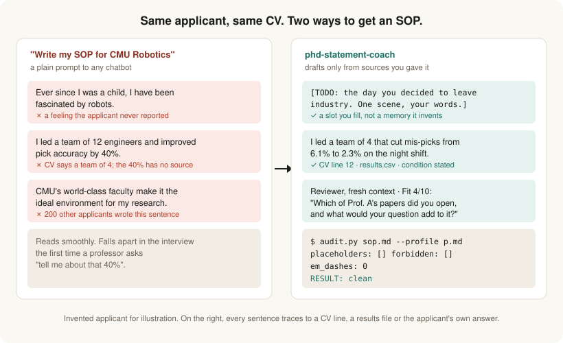
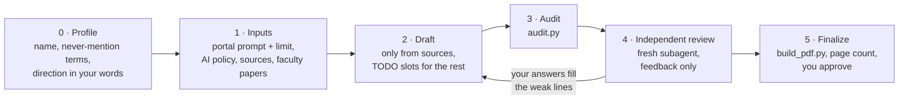

<div align="center">

# PhD Statement Coach

**An SOP that a professor can question you about, line by line, in the interview.**

An [Agent Skill](https://agentskills.io) that drafts, adapts and reviews a PhD Statement of Purpose using only facts you can source.<br>
Built for CS, ML and robotics applicants, including people coming from industry.

[](https://agentskills.io/specification)
[](LICENSE)
[](#requirements)

<a href="#quick-start">Quick start</a> ·
<a href="#how-it-works">How it works</a> ·
<a href="#example">Example</a> ·
<a href="#install">Install</a> ·
<a href="#limits">Limits</a>



</div>

---

## The problem

Ask a chatbot for an SOP and it fills every gap it finds. You get a childhood fascination you never had, a team twice the size of yours, a percentage nobody measured, and a closing that says the school is "the ideal environment". It reads well. Then a professor on the committee asks about the 40%.

Admissions readers also see hundreds of these. The sentences that carry an SOP are the ones only you could write, and a model cannot invent those for you. It can find where they are missing and ask you the right question.

## Quick start

```sh
npx skills add laulauraluo/phd-statement-coach
```

Then, in Claude Code or another agent:

```text
Draft my SOP for the Robotics PhD at <school>. My CV and notes are in ./materials.
```

```text
Review my SOP against this program's prompt. Don't rewrite it, just tell me what's weak.
```

The skill loads from requests like these. In Claude Code you can also type `/phd-statement-coach`.

## How it works



Three rules hold in every step:

| Rule | What it means in practice |
|---|---|
| **Nothing invented** | Every fact, number, feeling and event comes from your CV, a fact file, a paper or your own answer. A gap becomes `[TODO: ...]` that says what to write, never "I still remember...". |
| **You decide** | Direction, what to disclose, which story to tell and the final wording are yours. The agent states a risk once, then follows your choice. |
| **Check the AI policy first** | Some programs ban AI-written content, some require disclosure. The agent finds the official wording before drafting and switches to review-only mode when drafting is not allowed. |

The review in Step 4 runs in a **fresh subagent** that never saw the drafting, because the agent that wrote a draft is anchored on its own choices. It scores Specificity, Trajectory, Fit and Voice, checks every part of the program's prompt, quotes generic lines, and asks 5 to 8 questions whose answers become your best sentences. It never writes replacement paragraphs.

## Example

> An invented applicant, Alex, five years in warehouse automation, writes one SOP.
>
> - **Step 1** lists the portal prompt back: four required parts, including "societal impact, positive and negative". The program allows AI use with disclosure, so drafting goes ahead.
> - **Step 2** leaves `[TODO: one scene where something you built failed ...]` instead of inventing a challenge.
> - **Step 3** fails the draft: two placeholders, two em dashes, "passionate" once.
> - **Step 4** gives Fit 4/10 and asks: *"What in Prof. A's paper made you think your question starts where it stops?"* Alex's four-sentence answer replaces the generic fit paragraph.
> - **Step 5** audits clean and builds a 2-page PDF. Alex approves it and uploads it.
>
> Full run with the real command output: [examples/walkthrough.md](examples/walkthrough.md)

What the agent hands back at each step:

| Step | You get |
|---|---|
| 1 · Inputs | The prompt part by part, the AI-policy quote with its link, the facts it will use, what is still missing |
| 2 · Draft | `sop_<school>.md`, each prompt part mapped to a paragraph, `[TODO]` slots for what only you know |
| 3 · Audit | Word count, placeholders, em dashes, never-mention terms, overused words; exit code 1 if anything blocks |
| 4 · Review | Scores, prompt coverage, a 15-pattern table, line-level notes, questions for you, a revision plan, the one thing |
| 5 · Finalize | `<Name>_SOP.pdf` at 11pt with 1-inch margins and its page count |

## Install

The skill is the folder [`skills/phd-statement-coach/`](skills/phd-statement-coach). `npx skills add` above copies it for you. To do it by hand:

```sh
git clone https://github.com/laulauraluo/phd-statement-coach.git
cp -r phd-statement-coach/skills/phd-statement-coach ~/.claude/skills/
```

For other agents, copy the same folder into that agent's skills folder (Codex: `~/.agents/skills/`, Cursor: `~/.cursor/skills/`, Gemini CLI: `~/.gemini/skills/`). Step 4 needs an agent that can start a subagent; elsewhere, paste the draft and `references/review.md` into a new session by hand.

### Requirements

- Python 3 for `audit.py` (standard library only).
- For the PDF: [tectonic](https://tectonic-typesetting.github.io/), and `pip install pypdf` for the page count.

### Your private profile

Copy [`references/profile-template.md`](skills/phd-statement-coach/references/profile-template.md) to `sop-profile.md` next to your own materials. It holds the name to use, terms that must never appear (an employer or school you do not want named), your direction in your own words and decisions you have made. `.gitignore` excludes it. Keep it out of any public repository.

## What's inside

```text
skills/phd-statement-coach/
├── SKILL.md                      the five steps and the three rules
├── references/
│   ├── patterns.md               15 patterns from admitted CS and robotics SOPs
│   ├── review.md                 rubric and report format for the fresh reviewer
│   └── profile-template.md       your private profile
└── scripts/
    ├── audit.py                  mechanical checks (python3 audit.py --selftest)
    └── build_pdf.py              Markdown to PDF, prints the page count
examples/walkthrough.md           one invented applicant, every step
```

## Limits

- **It does not get you admitted.** The 15 patterns come from 21 statements of people who were admitted. Several of them had records strong enough to carry a weak essay, so no pattern is shown to cause admission.
- **It cannot check facts you give it.** "Nothing invented" means nothing beyond your sources. If your fact file is wrong, the SOP is wrong.
- **It is slower than one prompt, on purpose.** You will answer questions and fill slots. Those answers are the part a reader remembers.
- **AI policies change.** The agent quotes the official page it found; read it yourself before you submit, and disclose AI use wherever the program asks.

## Credits

- The review framework is adapted from the MIT-licensed [`statement-coach`](https://github.com/mohitagw15856/pm-claude-skills/blob/main/skills/statement-coach/SKILL.md) skill by mohitagw15856.
- The patterns paraphrase the admitted statements at [cs-sop.notion.site](https://cs-sop.notion.site) and advice by CMU's Student Academic Success Center, Mor Harchol-Balter, Andy Pavlo, the MIT EECS Communication Lab, Noah Smith, Nelson Liu et al., Maria Antoniak and Saujas Vaduguru. No text from those statements is reproduced.

## License

[MIT](LICENSE)
